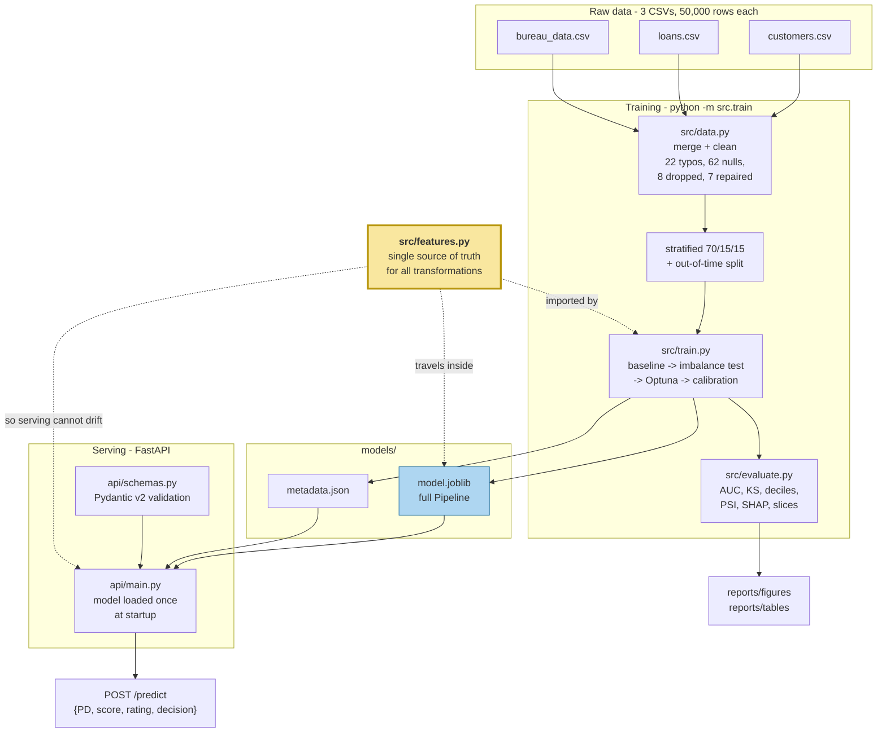

# Credit Default Risk Model

An end-to-end credit scorecard: it takes a loan application, and returns the probability
that the borrower will default, a 300–900 credit score, and an approve/decline
recommendation.

Everything is built to be **defensible**, not just accurate — every cleaning decision,
every feature, and every excluded column has a written reason, and the numbers below are
produced by `python -m src.train`, not typed by hand.

---

## The business problem

A lender has to decide, in the moment, whether to approve a loan. Approve a borrower who
defaults and you lose most of the principal. Decline a borrower who would have repaid and
you lose the interest you would have earned. The first mistake is roughly **ten times more
expensive** than the second.

So the job is not "predict defaults". The job is to **rank applicants by risk** and put
the cut-off where the expected cost is lowest. That framing drives three decisions that
run through this whole repo:

1. **Only application-time data.** The model may use nothing a lender would not have at
   the moment of the decision.
2. **Calibrated probabilities, not scores.** If you price a loan off the number, "8%" has
   to mean eight defaults per hundred.
3. **The threshold comes from a cost assumption**, not from 0.5.

---

## Results

Test set: 7,499 held-out loans, 8.59% default rate.

| Metric | Logistic baseline | **XGBoost (final)** | Out-of-time | What it means |
|---|---|---|---|---|
| ROC-AUC | 0.9834 | **0.9885** | 0.9855 | Chance a random defaulter is ranked riskier than a random repayer |
| PR-AUC | 0.8598 | **0.8862** | 0.8759 | The honest headline at an 8.6% base rate |
| Gini | 0.9668 | **0.9771** | 0.9711 | `2 × AUC − 1`; the number credit teams quote |
| KS | 88.14 | **90.30** | 90.40 | Max separation between good and bad. 30–40 is a healthy production scorecard |
| Brier | 0.0538 | **0.0240** | 0.0243 | Squared error of the probabilities — punishes bad calibration |

At the cost-optimal threshold of **0.080**:

| | Value |
|---|---|
| Defaults caught (recall) | **96.27%** |
| Precision | 58.16% |
| F1 | 0.7251 |
| Approval rate | 85.78% |
| Bad rate inside the approved book | **0.37%** (down from 8.59%) |

> ### ⚠️ Read this before quoting the AUC
>
> **0.9885 is not a realistic credit-model score.** A production consumer scorecard lands
> at 0.70–0.80. This number is high because the dataset is synthetic and the target was
> generated as a near-deterministic function of two bureau fields: applicants with low
> credit utilisation and no delinquency default at a rate of **exactly zero** — 0 out of
> 8,150.
>
> It is *not* leakage, and I checked three ways:
> * every feature is application-time, enforced by tests;
> * the leakage ablation (below) moves AUC by **−0.0001**;
> * the out-of-time model still scores 0.9855 — leakage does not survive a time split.
>
> **The method transfers. The numbers do not.** See
> [`docs/INTERVIEW_GUIDE.md`](docs/INTERVIEW_GUIDE.md#why-is-the-auc-so-high).

### The leakage ablation

`principal_outstanding` is the loan balance part-way through repayment — a lender does not
have it at application time. I excluded it, then measured what including it would have
done:

| Feature set | Test ROC-AUC |
|---|---|
| Application-time only (production model) | 0.98882 |
| **+ `principal_outstanding`** | 0.98868 |
| **Inflation** | **−0.00014** |

It adds nothing (its raw correlation with `default` is −0.011). The point is that I
measured it rather than assuming, and the model excludes it on principle regardless —
a feature you cannot obtain at scoring time is unusable no matter what it does to the score.

### Rank ordering (test set)

| Decile | Loans | Defaults | Default rate | Lift |
|---|---|---|---|---|
| 1 (riskiest) | 750 | 560 | 74.67% | 8.69× |
| 2 | 750 | 84 | 11.20% | 1.30× |
| 3 | 750 | 0 | 0.00% | 0.00× |
| 4–10 | 5,249 | 0 | 0.00% | 0.00× |

Perfectly monotone, and **100% of defaults sit in the top two deciles**. That extreme
concentration is the synthetic-data effect described above; on real data you would expect
decile 1 around 25–30% and a smooth decay.

---

## Architecture



**The yellow box is the important one.** `src/features.py` is imported by training *and*
serialized into the model artifact, so the API physically cannot compute a feature
differently from how it was computed at training time. That is the answer to "how do you
prevent training/serving skew?" — it is not a process, it is a structural guarantee, and
`tests/test_api.py::test_prediction_matches_what_train_py_recorded` asserts it.

---

## Repo layout

```
src/
  config.py      paths, seed, cost assumptions, score bands
  data.py        load + merge + clean (every rule counted and logged)
  features.py    feature engineering - imported by BOTH training and serving
  pipeline.py    sklearn Pipeline construction
  train.py       trains, tunes, calibrates, evaluates, saves artifacts
  evaluate.py    AUC/KS/PSI/deciles/score mapping/fairness slices
api/
  main.py        FastAPI app, lifespan model loading, structured logging
  schemas.py     Pydantic v2 request/response models
models/
  model.joblib   the full pipeline: raw fields -> features -> encode -> XGB -> calibration
  metadata.json  version, date, features, every metric, the prediction fixture
tests/           65 tests: cleaning counts, feature guards, metrics, API contract
reports/
  figures/       11 plots
  tables/        decile tables, PSI, SHAP, fairness slices, Optuna trials
notebooks/       EDA only (executed, with outputs)
docs/            MODEL_CARD.md, INTERVIEW_GUIDE.md
data/raw/        the three source CSVs
```

---

## Quickstart

```bash
git clone <this-repo> && cd Credit_Risk_Modelling

python3.11 -m venv .venv
source .venv/bin/activate
pip install -r requirements.txt

# macOS only: XGBoost needs the OpenMP runtime
brew install libomp

python -m src.train              # ~3 minutes, writes models/ and reports/
pytest tests/ -q                 # 65 tests
uvicorn api.main:app --reload    # http://localhost:8000/docs
```

`python -m src.train --trials 5 --skip-shap` runs in ~20 seconds if you just want
artifacts to exist.

Everything is seeded (`config.RANDOM_SEED = 42`) and reproduces exactly run to run.

---

## API

Interactive docs at `/docs`. All examples below are **real, copy-pasteable responses**.

### `POST /predict`

```bash
curl -s -X POST http://localhost:8000/predict \
  -H 'Content-Type: application/json' \
  -d '{
    "age": 24, "income": 380000, "number_of_dependants": 1,
    "years_at_current_address": 17, "marital_status": "Single",
    "employment_status": "Salaried", "residence_type": "Owned",
    "loan_purpose": "Education", "loan_type": "Secured",
    "sanction_amount": 796000, "loan_amount": 683000,
    "loan_tenure_months": 51, "bank_balance_at_application": 113045,
    "number_of_open_accounts": 1, "number_of_closed_accounts": 1,
    "total_loan_months": 60, "delinquent_months": 9, "total_dpd": 40,
    "enquiry_count": 1, "credit_utilization_ratio": 85
  }'
```

```json
{
  "probability_of_default": 0.357143,
  "credit_score": 686,
  "rating": "Good",
  "decision": "decline",
  "threshold": 0.08,
  "model_version": "1.0.0"
}
```

A "Good" rating with a **decline** is not a bug: the rating band describes the applicant
relative to the whole population, while the decision compares their 35.7% PD against the
0.08 cut-off. High utilisation (85%) and delinquency in 9 of 60 months drive the risk.

A low-risk applicant (`tests/fixtures/example_applicant.json`) returns:

```json
{"probability_of_default": 0.0001, "credit_score": 900, "rating": "Excellent",
 "decision": "approve", "threshold": 0.08, "model_version": "1.0.0"}
```

### `POST /predict/batch`

```bash
curl -s -X POST http://localhost:8000/predict/batch \
  -H 'Content-Type: application/json' \
  -d @tests/fixtures/example_batch.json
```

```json
{
  "predictions": [
    {"probability_of_default": 0.0001,   "credit_score": 900, "rating": "Excellent", "decision": "approve", "threshold": 0.08, "model_version": "1.0.0"},
    {"probability_of_default": 0.357143, "credit_score": 686, "rating": "Good",      "decision": "decline", "threshold": 0.08, "model_version": "1.0.0"},
    {"probability_of_default": 0.9999,   "credit_score": 300, "rating": "Poor",      "decision": "decline", "threshold": 0.08, "model_version": "1.0.0"}
  ],
  "count": 3
}
```

Up to 1,000 applicants per call. One invalid applicant rejects the whole batch — partial
success would be worse, because the caller could not tell which index was skipped.

### `GET /health`

```json
{"status": "ok", "model_loaded": true, "model_version": "1.0.0", "uptime_seconds": 0.5}
```

### `GET /model/info`

Returns the version, training date, full feature list, every headline metric, the threshold
and its cost assumption, and the leakage-ablation result.

### Validation

Bad input returns **422 with a readable message**, never a 500:

```bash
curl -s -X POST http://localhost:8000/predict -H 'Content-Type: application/json' -d '{"age": 15, ...}'
```

```json
{"detail": [{"type": "greater_than_equal", "loc": ["body", "age"],
             "msg": "Input should be greater than or equal to 18", "input": 15,
             "ctx": {"ge": 18}}]}
```

Enforced: `age` 18–100, `income` > 0, `credit_utilization_ratio` 0–100, enums for all
categoricals, plus cross-field rules — `loan_amount ≤ sanction_amount`,
`delinquent_months ≤ total_loan_months`, `total_dpd = 0` when `delinquent_months = 0`,
and at least one credit account.

### Latency

Measured locally, 300 requests after warm-up:

| | p50 | p95 | p99 |
|---|---|---|---|
| `POST /predict` | 3.62 ms | 3.83 ms | 4.32 ms |

Batching amortises the overhead: 1,000 applicants in **12.6 ms total** (0.013 ms each).
The model is loaded once in a lifespan handler; loading it per request would dominate this
budget entirely.

---

## Data and cleaning

Three tables, 50,000 rows each, joined one-to-one on `cust_id`.

| # | Problem | Rows | Decision |
|---|---|---|---|
| 1 | `loan_purpose` spelled `Personaal` | 22 | Normalised to `Personal` — both spellings default at 4.5%, so it is a typo, not a product |
| 2 | `residence_type` null | 62 | Explicit **`Unknown`** category, not the mode. Imputing the mode assigns them "Owned", the *lowest-risk* level (5.6% vs 16.3% Rented) — that silently labels them safe |
| 3 | Every money column = 0 | 8 | **Dropped.** Not loans; every ratio feature is 0/0 |
| 4 | `gst` "implausible" | 49,992 | **Dropped**, but the real reason is stronger than the prompt's: `gst` is *exactly* 18% of `loan_amount`, `processing_fee` 2%, `net_disbursement` 80%. All three carry **zero** independent information |
| 5 | Disbursement identity fails | 7 | **Repaired, not dropped** — see below |
| 6 | `processing_fee` up to 148% of loan | 7 | **The same 7 rows as #5** |

### On #5 and #6

The prompt listed these as two problems. They are one. `processing_fee` is corrupted on
exactly 7 rows; `gst` and `net_disbursement` are still correct there, so the true fee is
recoverable **exactly** as `gst / 9`, and the repair is confirmed independently by the
identity `loan_amount − processing_fee − gst = net_disbursement`, which goes from 7
violations to **0**.

Repair beats dropping: nothing is guessed — two identities force the value — and 7 valid
applications are kept. (`processing_fee` is post-approval and never reaches the model
anyway; this is bookkeeping hygiene so the EDA and identity checks are honest.)

**49,992 rows survive**, and `tests/test_data.py` asserts every count above.

---

## Features

23 raw application-time inputs → **22 features** (17 numeric + 5 categorical).

| Feature | Credit intuition |
|---|---|
| `loan_to_income` | The oldest underwriting ratio. Asking for 5× your income is stretched; 0.5× is not |
| `emi_to_monthly_income` | A crude FOIR/DTI. What actually breaks a borrower is whether the *monthly payment* fits the monthly budget |
| `loan_to_sanction` | Drawing the full approved limit signals the applicant needed every rupee |
| `balance_to_loan` | Liquidity cushion — savings absorb the first bad month |
| `months_of_income_in_bank` | The same cushion, scale-free, so a high and a low earner compare fairly |
| `income_per_dependant` | Same salary, four dependants — not the same disposable income |
| `delinquency_ratio` | Share of credit history spent delinquent. Past repayment is the best predictor of future repayment |
| `avg_dpd_per_delinquency` | Separates "a few days late, often" from "90 days dark". Guarded — 40% of borrowers have zero delinquent months |
| `credit_utilization_ratio` | Already leaning on credit to make ends meet |
| `open_account_ratio` | Accumulating obligations vs. a record of closing them out |
| `total_accounts` | File depth — thin files are hard to judge, very thick ones suggest credit hunger |

Plus `enquiry_count`, `loan_tenure_months`, `total_loan_months`, `age`,
`years_at_current_address`, `number_of_dependants` used as-is, and one-hot
`marital_status`, `employment_status`, `residence_type`, `loan_purpose`, `loan_type`.

### What is deliberately excluded

| Excluded | Why |
|---|---|
| `principal_outstanding` | Post-disbursal. Ablation: **−0.0001 AUC**, so nothing is lost |
| `processing_fee`, `gst`, `net_disbursement` | Post-approval, *and* exact linear functions of `loan_amount` |
| `installment_start_dt` | Post-approval |
| `cust_id`, `loan_id` | Identifiers. A model that learns from an ID has memorised the training set |
| `city`, `state`, `zipcode` | Low cardinality (10/9/10) and **flat default rates** (8.1–9.1%, inside noise). No signal, and geography is a classic redlining proxy |
| `gender` | Protected characteristic (ECOA/Reg B, RBI fair practices). Rates are 8.79% F vs 8.47% M — indistinguishable, so there is **no accuracy cost**. Retained in the raw frame purely to *audit* fairness |
| `disbursal_date` | Used to build the out-of-time split, but no month/quarter feature: the default rate is flat across all 21 quarters (7.8–9.6%), so it would only encode noise — and it would be the first thing to drift |

Top features by SHAP: `credit_utilization_ratio` (4.94), `delinquency_ratio` (2.30),
`loan_to_income` (1.43), `residence_type_Owned` (0.98), `residence_type_Rented` (0.73).

---

## Modelling decisions

**Class imbalance (8.6% positives).** Three strategies, measured on validation:

| Strategy | ROC-AUC | PR-AUC | Brier |
|---|---|---|---|
| Do nothing | 0.9889 | **0.8991** | **0.0239** |
| `scale_pos_weight = 10.63` | 0.9887 | 0.8990 | 0.0362 |
| Random undersampling (28,978 good loans discarded) | 0.9875 | 0.8896 | 0.0485 |

Undersampling clearly lost — it throws away 90% of the majority class and the information
about what a good borrower looks like. "Do nothing" and `scale_pos_weight` were a tie on
ranking. **I kept `scale_pos_weight`** because it makes the minority-class gradient
explicit and is the standard, defensible choice; its worse raw Brier is then fixed by
calibration, which is what calibration is for.

**Tuning.** Optuna, 40 trials, 4-fold stratified CV on train+validation, early stopping
inside each fold. Best CV AUC 0.98900. The test set is untouched throughout.
Winner: `max_depth=3`, `learning_rate=0.061`, `subsample=0.705`, `colsample_bytree=0.997`,
`min_child_weight=13`, `gamma=3.93`, `reg_lambda=0.535`, `reg_alpha=0.029`.

**Calibration.** Raw XGBoost margins are not probabilities. Both calibrators were fitted on
one half of validation and compared on the *other* half — never on test, which would be
tuning on the holdout.

| Method | ROC-AUC | Brier | ECE |
|---|---|---|---|
| None (raw) | 0.9888 | 0.0381 | 0.0479 |
| **Isotonic** ✅ | 0.9885 | **0.0240** | **0.0063** |
| Sigmoid (Platt) | 0.9888 | 0.0262 | 0.0159 |

Isotonic cuts calibration error by **7.6×**. It costs a hair of PR-AUC (0.9009 → 0.8862)
because it is a step function that ties nearby scores — a fair trade when the number is
used for pricing.

Reported PDs are clamped to `[0.0001, 0.9999]`: isotonic's end steps are exactly 0 and 1,
and no lender can price off "this borrower will never default". The clamp is monotone, so
no ranking metric changes.

**Threshold.** Assumed cost of a false negative = 0.60 of exposure (loss given default);
false positive = 0.06 (lost interest margin). A missed default is ~10× worse, so the
cut-off sits far below 0.5. Chosen on validation, applied unchanged to test:

| Threshold | Recall | Precision | Approval rate | Bad rate approved | Defaults missed |
|---|---|---|---|---|---|
| **0.080** (cost-optimal) | **96.27%** | 58.16% | 85.78% | **0.37%** | **24** |
| 0.500 (naive) | 73.45% | 85.07% | 92.59% | 2.46% | 171 |

The naive threshold approves 6.8 points more of the book, but misses **171 defaults
instead of 24** and carries a **6.6× higher bad rate** in the approved portfolio. Under
the stated costs that trade is clearly bad: the extra interest margin on the additional
approvals does not come close to covering 147 more defaults.

---

## Monitoring

**PSI** (Population Stability Index) compares the training feature distribution against
live traffic. Below 0.10 is stable, 0.10–0.25 warrants investigation, above 0.25 means
retrain. Current maxima: **0.0036** train vs test, **0.0023** in-time vs out-of-time —
both far inside "stable", as expected when both sides come from one generated population.

In production I would alarm on: PSI > 0.25 on any top-5 feature; the approval rate moving
more than 5 points; observed default rate in the approved book drifting from predicted;
and p99 latency. Full retraining triggers are in the interview guide.

---

## Fairness

Sliced on the test set at the shared 0.08 threshold (full tables in `reports/tables/`):

| Slice | n | AUC | Approval rate | Recall |
|---|---|---|---|---|
| Male | 4,515 | 0.9902 | 86.45% | 96.57% |
| Female | 2,984 | 0.9859 | 84.79% | 95.85% |
| Salaried | 2,652 | 0.9881 | 85.26% | 97.06% |
| Self-Employed | 4,847 | 0.9889 | 86.07% | 95.81% |
| Owned | 4,269 | 0.9923 | 89.79% | 98.78% |
| Rented | 1,441 | 0.9798 | 75.71% | 94.02% |

The 1.7-point gender gap in approval rate tracks the 0.5-point difference in *actual*
default rate, and gender is not a model input. The 14-point gap between Owned and Rented
is much larger — and it tracks a real 3× difference in default rate (5.7% vs 16.2%).
Whether housing tenure is an acceptable basis for a lending decision is a policy question,
not a modelling one, and it is flagged in [`docs/MODEL_CARD.md`](docs/MODEL_CARD.md).

---

## Reports

`reports/figures/` — ROC/PR curves, KS curve, reliability curve, decile rank ordering,
score distribution, cost-vs-threshold, SHAP global importance, SHAP beeswarm, and three
individual SHAP force plots (highest-risk, lowest-risk, borderline applicant).

`reports/tables/` — decile tables (test and OOT), PSI reports, SHAP importances, Optuna
trial history, imbalance and calibration comparisons, six fairness slice tables.

---

## Deployment

The `Dockerfile` is a two-stage build on `python:3.11-slim`: the wheel toolchain stays in
the builder, the runtime installs only `requirements-api.txt` (no Optuna, SHAP,
matplotlib or seaborn — roughly half the image and far less attack surface), runs as
non-root uid 10001, and has a `HEALTHCHECK` against `/health`.

> **Verification status.** The Docker daemon was not running on the build machine, so the
> image itself is **unbuilt and untested**. What *was* verified: the API boots and serves
> correct predictions from a clean virtualenv containing only `requirements-api.txt` — so
> the container's dependency contract is confirmed even though the image is not. The CI
> workflow builds the image and smoke-tests `/health` and `/predict` on every push.

### Deploying to Render

Steps 1–4 need a browser and your account, so they are yours to do:

1. **Push the repo to GitHub.**
   ```bash
   git add -A
   git commit -m "Credit default risk model: training pipeline, API, tests, docs"
   git push origin main
   ```
   `models/model.joblib` (~150 KB) and `models/metadata.json` are committed on purpose —
   the image copies them in, and Render does not train.

2. **Sign in** at [dashboard.render.com](https://dashboard.render.com) (GitHub login is
   easiest).

3. **New → Blueprint**, pick this repository, and confirm. Render reads `render.yaml` and
   provisions a free Docker web service named `credit-risk-api`.

4. **Wait ~5 minutes** for the first build. Watch the log for
   `{"event": "startup", "model_version": "1.0.0", ...}` — that line means the model
   loaded. If it is missing, the app exited on purpose because the artifact was not there.

5. **Verify:**
   ```bash
   curl https://credit-risk-api.onrender.com/health
   curl -X POST https://credit-risk-api.onrender.com/predict \
     -H 'Content-Type: application/json' -d @tests/fixtures/example_applicant.json
   ```

6. **Live URL:** `https://credit-risk-api.onrender.com/docs`
   — _fill this in once step 3 completes; I could not deploy it for you because it needs
   your Render login._

Free-tier caveat: the instance sleeps after 15 minutes idle, so the first request after a
nap takes 30–50 seconds. Every subsequent one is back to the ~4 ms above.

**To run it locally instead** (once Docker is running):

```bash
docker build -t credit-risk-api .
docker run -p 8000:8000 credit-risk-api
curl http://localhost:8000/health
```

**Fly.io** as an alternative: `fly launch --dockerfile Dockerfile` then `fly deploy`; it
reads the same `Dockerfile` and needs no other change.

### CI

`.github/workflows/ci.yml` runs on every push and PR: ruff lint, a fast 5-trial training
run to produce artifacts, the full pytest suite, then a second job that builds the Docker
image, boots it, and asserts `/health` reports `"model_loaded": true` and `/predict`
returns a probability.

---

## Where this model is weak

1. **The metrics do not transfer.** Synthetic data with a near-deterministic target. On a
   real book, expect AUC 0.70–0.80 and a decile-1 rate near 25%.
2. **The score is effectively bimodal** — 94.5% of the test book lands at Excellent
   (6,532) or Poor (556), leaving only 5.5% in the Good and Average bands combined.
   Risk-based pricing needs a smooth spectrum. This is a data property, not a calibration
   artefact: Platt scaling is *more* concentrated still, at 97.3%.
3. **One snapshot per borrower.** No repeat applications, no behavioural history, no
   macroeconomic covariates — and the default rate is flat across all five years, so the
   model has never seen a downturn.
4. **`default` is undefined.** 90 days past due? Written off? The definition drives
   everything and it is not documented with the data.
5. **Housing tenure does heavy lifting** (14-point approval gap), which needs a fair-lending
   review before this went anywhere near production.

---

## Documentation

- **[`docs/INTERVIEW_GUIDE.md`](docs/INTERVIEW_GUIDE.md)** — the full walkthrough: how
  gradient boosting works in plain words, every hyperparameter and which way it pushes
  bias/variance, every metric defined with the actual number, the leakage story, and ~20
  interview questions answered, including the hostile ones.
- **[`docs/MODEL_CARD.md`](docs/MODEL_CARD.md)** — intended use, training data,
  performance by segment, limitations, ethical considerations.
- **[`notebooks/01_exploratory_data_analysis.ipynb`](notebooks/01_exploratory_data_analysis.ipynb)** —
  executed EDA showing how each cleaning decision was reached.
